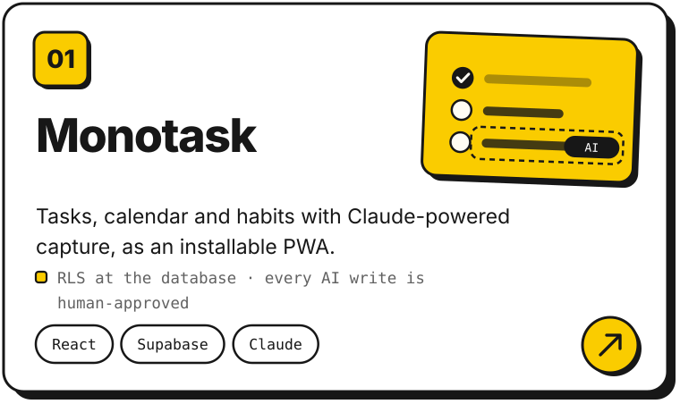
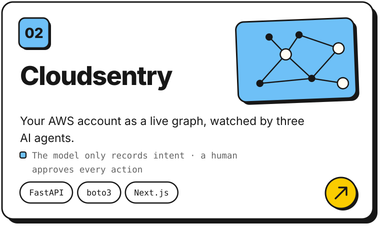
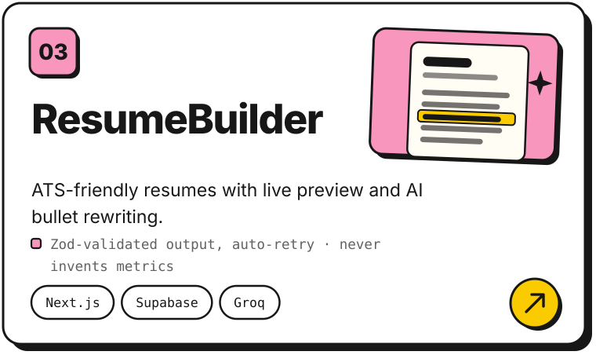
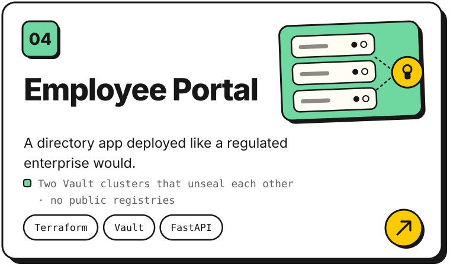
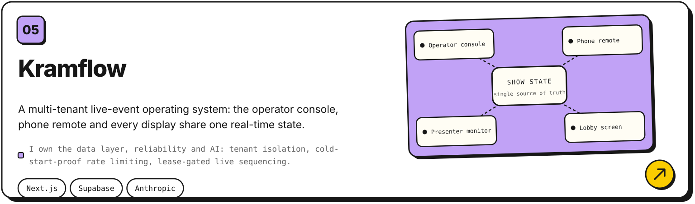
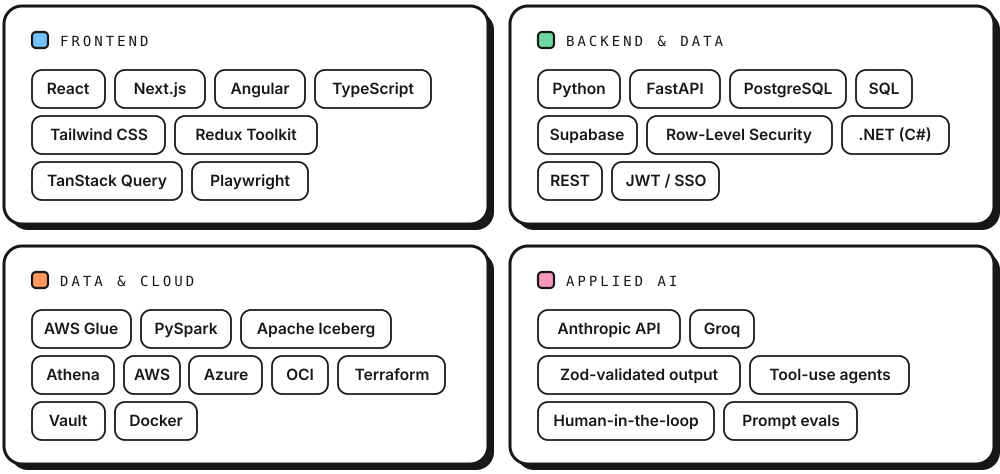

<picture><source media="(prefers-color-scheme: dark)" srcset="assets/banner-dark.276e15e2.svg"></picture>

<picture><source media="(prefers-color-scheme: dark)" srcset="assets/marquee-dark.dbc9ff60.svg"></picture>

 

<a href="https://sakar-portfolio-pearl.vercel.app"><picture><source media="(prefers-color-scheme: dark)" srcset="assets/btn-portfolio-dark.78acb9bb.svg"></picture></a>&nbsp;
<a href="https://www.linkedin.com/in/sakar-joshi/"><picture><source media="(prefers-color-scheme: dark)" srcset="assets/btn-linkedin-dark.2598a98d.svg"></picture></a>

  

<picture><source media="(prefers-color-scheme: dark)" srcset="assets/impact-dark.abe9a5a5.svg"></picture>

 

<picture><source media="(prefers-color-scheme: dark)" srcset="assets/h-work-dark.d78ef78b.svg"></picture>

  <a href="https://github.com/Sakar1601/Monotask"><picture><source media="(prefers-color-scheme: dark)" srcset="assets/card-monotask-dark.538c98a9.svg"></picture></a>
  <a href="https://github.com/Sakar1601/cloudsentry"><picture><source media="(prefers-color-scheme: dark)" srcset="assets/card-cloudsentry-dark.e8f5684c.svg"></picture></a>
  <a href="https://github.com/Sakar1601/resume-builder-app"><picture><source media="(prefers-color-scheme: dark)" srcset="assets/card-resume-dark.d158e4be.svg"></picture></a>
  <a href="https://github.com/Sakar1601/internal-employee-portal"><picture><source media="(prefers-color-scheme: dark)" srcset="assets/card-portal-dark.614674ca.svg"></picture></a>
  <a href="https://github.com/Workflow-bench/kramflow"><picture><source media="(prefers-color-scheme: dark)" srcset="assets/card-kramflow-dark.fb9bfb0e.svg"></picture></a>

<b>Live:</b> <a href="https://monotask.vercel.app">Monotask</a> &nbsp;·&nbsp; <a href="https://sakar1601.github.io/cloudsentry/">Cloudsentry demo</a> &nbsp;·&nbsp; <a href="https://resume-builder-app-phi.vercel.app">ResumeBuilder</a> &nbsp;·&nbsp; <a href="https://sakar1601.github.io/internal-employee-portal/">Employee Portal demo</a> &nbsp;·&nbsp; <a href="https://kramflow.me">Kramflow</a>

 

<picture><source media="(prefers-color-scheme: dark)" srcset="assets/h-experience-dark.361f19a4.svg"></picture>

<picture><source media="(prefers-color-scheme: dark)" srcset="assets/experience-dark.b6caf3f9.svg"></picture>

M.S. Information Technology, Arizona State University &nbsp;·&nbsp; B.E. Computer Engineering, Kadi Sarva Vishwavidyalaya

 

<picture><source media="(prefers-color-scheme: dark)" srcset="assets/h-capabilities-dark.3fae9094.svg"></picture>

<picture><source media="(prefers-color-scheme: dark)" srcset="assets/capabilities-dark.e43b7a16.svg"></picture>

 

<picture><source media="(prefers-color-scheme: dark)" srcset="assets/h-github-dark.9502d759.svg"></picture>

<picture><source media="(prefers-color-scheme: dark)" srcset="assets/github-dark.f32e5ec4.svg"></picture>

 

Same design language as my <a href="https://sakar-portfolio-pearl.vercel.app">portfolio</a>. The visuals are SVGs generated by <a href=".github/scripts/generate.py">a small script</a>; the GitHub numbers refresh daily through a <a href=".github/workflows/profile-assets.yml">GitHub Action</a>.

