

<picture><source media="(prefers-color-scheme: dark)" srcset="assets/banner-dark.20fe8774.svg"></picture>

<picture><source media="(prefers-color-scheme: dark)" srcset="assets/marquee-dark.6c7e9638.svg"></picture>

 

<a href="https://sakar-portfolio-pearl.vercel.app"><picture><source media="(prefers-color-scheme: dark)" srcset="assets/btn-portfolio-dark.78acb9bb.svg"></picture></a>&nbsp;
<a href="https://www.linkedin.com/in/sakar-joshi/"><picture><source media="(prefers-color-scheme: dark)" srcset="assets/btn-linkedin-dark.2598a98d.svg"></picture></a>&nbsp;
<a href="mailto:sakar.joshi1601@gmail.com"><picture><source media="(prefers-color-scheme: dark)" srcset="assets/btn-email-dark.048d7fc2.svg"></picture></a>&nbsp;
<a href="https://sakar-portfolio-pearl.vercel.app/Sakar_CV_.pdf"><picture><source media="(prefers-color-scheme: dark)" srcset="assets/btn-resume-dark.11e092df.svg"></picture></a>

  

<picture><source media="(prefers-color-scheme: dark)" srcset="assets/impact-dark.abe9a5a5.svg"></picture>

 

<picture><source media="(prefers-color-scheme: dark)" srcset="assets/h-work-dark.d78ef78b.svg"></picture>

  <a href="https://github.com/Sakar1601/Monotask"><picture><source media="(prefers-color-scheme: dark)" srcset="assets/card-monotask-dark.a9a92ab1.svg">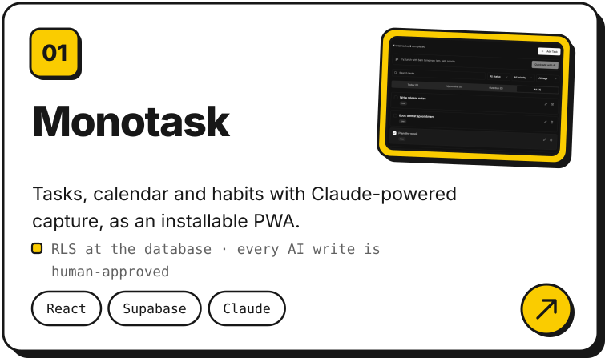</picture></a>
  <a href="https://github.com/Sakar1601/cloudsentry"><picture><source media="(prefers-color-scheme: dark)" srcset="assets/card-cloudsentry-dark.4615265b.svg">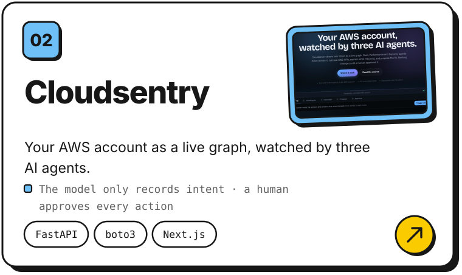</picture></a>
  <a href="https://github.com/Sakar1601/resume-builder-app"><picture><source media="(prefers-color-scheme: dark)" srcset="assets/card-resume-dark.ec36339c.svg">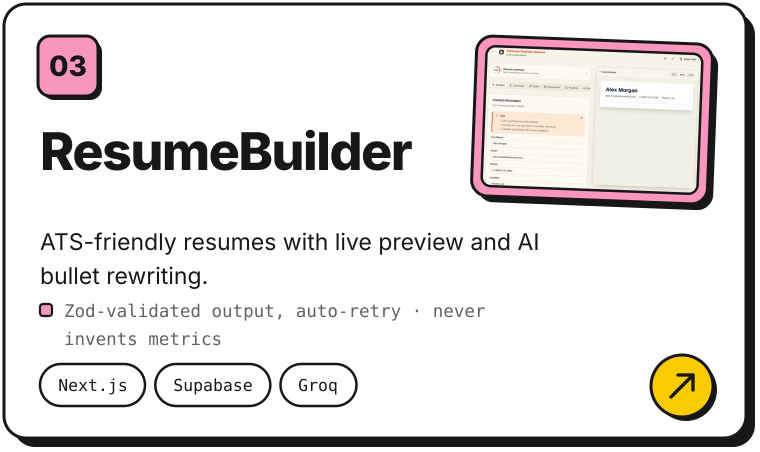</picture></a>
  <a href="https://github.com/Sakar1601/internal-employee-portal"><picture><source media="(prefers-color-scheme: dark)" srcset="assets/card-portal-dark.3297172b.svg">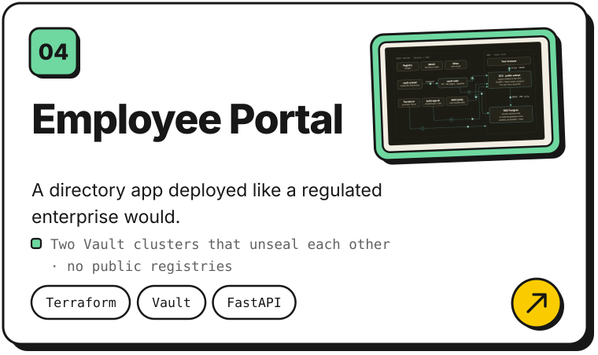</picture></a>
  <a href="https://github.com/Workflow-bench/kramflow"><picture><source media="(prefers-color-scheme: dark)" srcset="assets/card-kramflow-dark.531b9745.svg">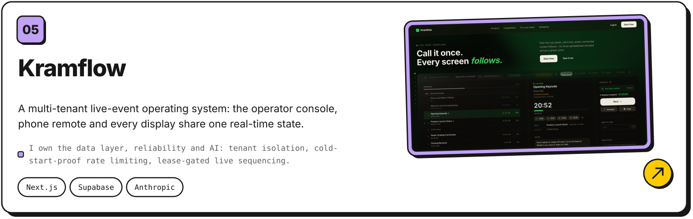</picture></a>

<b>Live:</b> <a href="https://monotask.vercel.app">Monotask</a> &nbsp;·&nbsp; <a href="https://sakar1601.github.io/cloudsentry/">Cloudsentry demo</a> &nbsp;·&nbsp; <a href="https://resume-builder-app-phi.vercel.app">ResumeBuilder</a> &nbsp;·&nbsp; <a href="https://sakar1601.github.io/internal-employee-portal/">Employee Portal demo</a> &nbsp;·&nbsp; <a href="https://kramflow.me">Kramflow</a>

 

<picture><source media="(prefers-color-scheme: dark)" srcset="assets/h-experience-dark.361f19a4.svg"></picture>

<picture><source media="(prefers-color-scheme: dark)" srcset="assets/experience-dark.89e4c881.svg">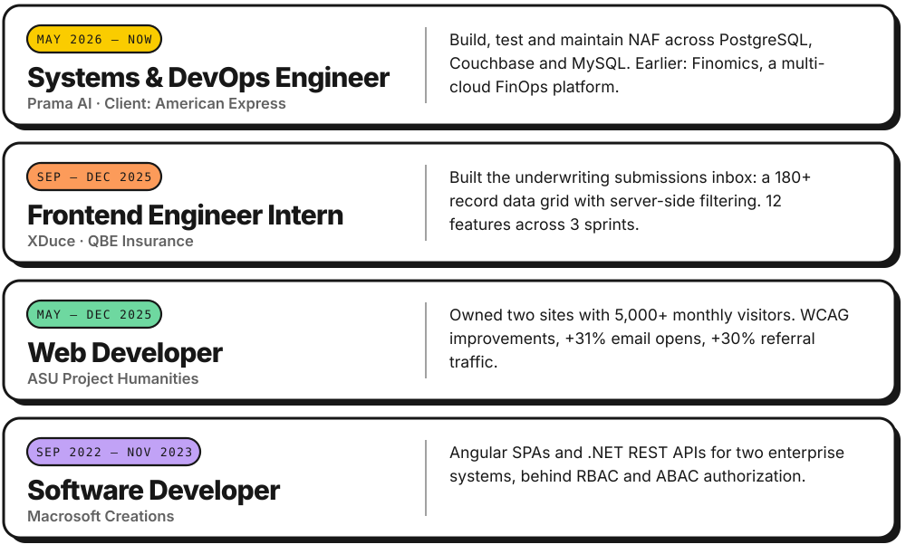</picture>

<picture><source media="(prefers-color-scheme: dark)" srcset="assets/education-dark.3bae8e73.svg">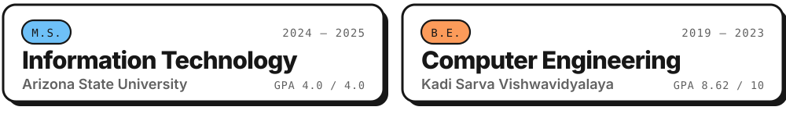</picture>

<b>CERTIFICATIONS</b> 
<a href="https://www.credly.com/badges/d5e2cd91-379a-4773-878a-c9231329d95b/linked_in_profile"><picture><source media="(prefers-color-scheme: dark)" srcset="assets/cert-1-dark.0fe96579.svg">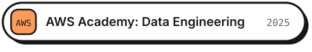</picture></a>
<a href="https://www.credly.com/badges/c63b902e-0028-4d65-b47a-8d2002f2749f/linked_in_profile"><picture><source media="(prefers-color-scheme: dark)" srcset="assets/cert-2-dark.7cb9fb17.svg">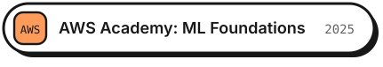</picture></a>
<a href="https://www.credly.com/badges/82947456-3b9b-43ab-b013-52ad9de560e9/linked_in_profile"><picture><source media="(prefers-color-scheme: dark)" srcset="assets/cert-3-dark.cc958aa2.svg">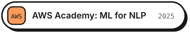</picture></a>

 

<picture><source media="(prefers-color-scheme: dark)" srcset="assets/h-capabilities-dark.3fae9094.svg"></picture>

<picture><source media="(prefers-color-scheme: dark)" srcset="assets/capabilities-dark.9ec00485.svg">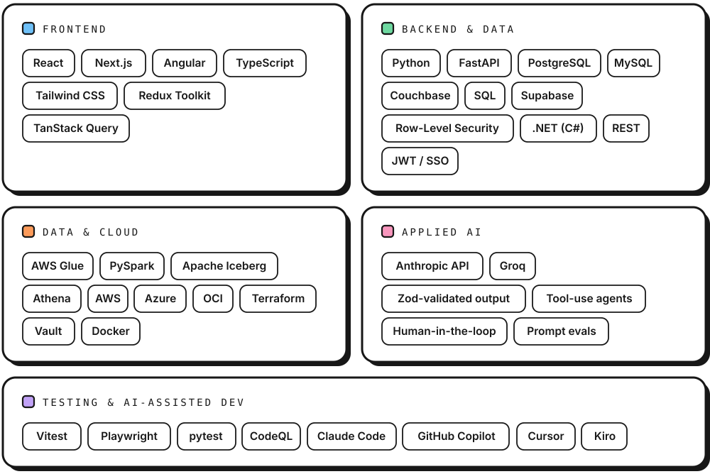</picture>

 

<picture><source media="(prefers-color-scheme: dark)" srcset="assets/h-github-dark.9502d759.svg"></picture>

<picture><source media="(prefers-color-scheme: dark)" srcset="assets/github-dark.0c3ce857.svg">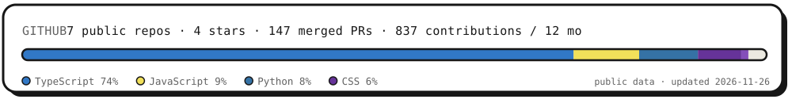</picture>

 

Same design language as my <a href="https://sakar-portfolio-pearl.vercel.app">portfolio</a>. The visuals are SVGs generated by <a href=".github/scripts/generate.py">a small script</a>; the GitHub numbers refresh daily through a <a href=".github/workflows/profile-assets.yml">GitHub Action</a>.

