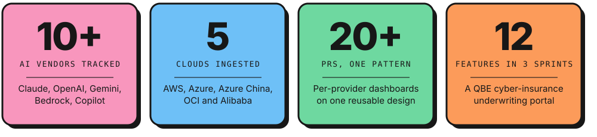
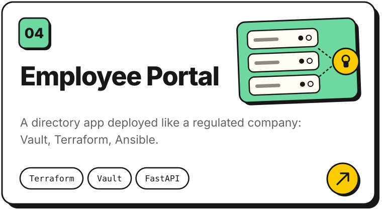
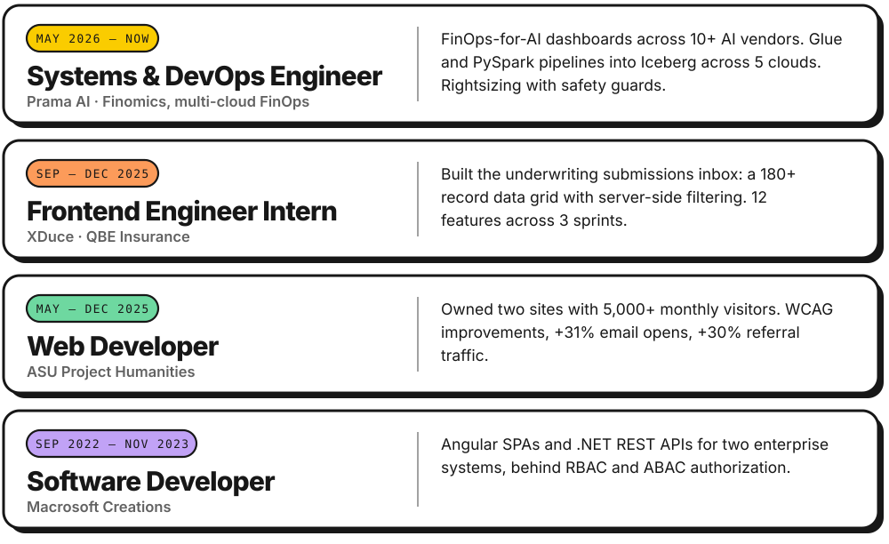
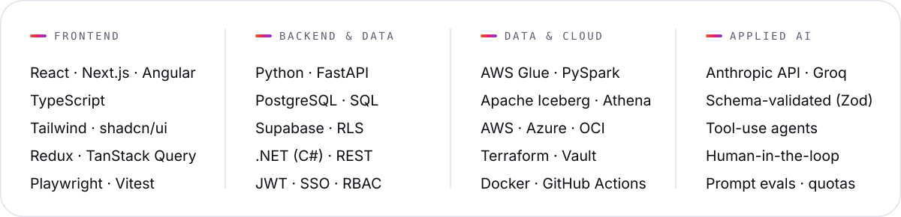

<picture><source media="(prefers-color-scheme: dark)" srcset="assets/hero-dark.svg"></picture>

 

<picture><source media="(prefers-color-scheme: dark)" srcset="assets/impact-dark.svg"></picture>

 

<picture><source media="(prefers-color-scheme: dark)" srcset="assets/h-work-dark.svg"></picture>

  <a href="https://github.com/Sakar1601/Monotask"><picture><source media="(prefers-color-scheme: dark)" srcset="assets/card-monotask-dark.svg"></picture></a>
  <a href="https://github.com/Sakar1601/cloudsentry"><picture><source media="(prefers-color-scheme: dark)" srcset="assets/card-cloudsentry-dark.svg"></picture></a>
  <a href="https://github.com/Sakar1601/resume-builder-app"><picture><source media="(prefers-color-scheme: dark)" srcset="assets/card-resume-dark.svg"></picture></a>
  <a href="https://github.com/Sakar1601/internal-employee-portal"><picture><source media="(prefers-color-scheme: dark)" srcset="assets/card-portal-dark.svg"></picture></a>

<b>Live:</b> <a href="https://monotask.vercel.app">Monotask</a> &nbsp;·&nbsp; <a href="https://sakar1601.github.io/cloudsentry/">Cloudsentry demo</a> &nbsp;·&nbsp; <a href="https://resume-builder-app-phi.vercel.app">ResumeBuilder</a> &nbsp;·&nbsp; <a href="https://sakar1601.github.io/internal-employee-portal/">Employee Portal demo</a> &nbsp;·&nbsp; <a href="https://kramflow.me">Kramflow</a> (real-time live-event operating system; I own the data layer, reliability and AI features)

 

<picture><source media="(prefers-color-scheme: dark)" srcset="assets/h-experience-dark.svg"></picture>

<picture><source media="(prefers-color-scheme: dark)" srcset="assets/experience-dark.svg"></picture>

M.S. Information Technology, Arizona State University &nbsp;·&nbsp; B.E. Computer Engineering, Kadi Sarva Vishwavidyalaya

 

<picture><source media="(prefers-color-scheme: dark)" srcset="assets/h-capabilities-dark.svg"></picture>

<picture><source media="(prefers-color-scheme: dark)" srcset="assets/capabilities-dark.svg"></picture>

 

<picture><source media="(prefers-color-scheme: dark)" srcset="assets/h-github-dark.svg"></picture>

<picture><source media="(prefers-color-scheme: dark)" srcset="assets/github-dark.svg"></picture>

 

<a href="https://www.linkedin.com/in/sakar-joshi/"><picture><source media="(prefers-color-scheme: dark)" srcset="assets/btn-linkedin-dark.svg"></picture></a>&nbsp;
<a href="https://sakar-portfolio-pearl.vercel.app"><picture><source media="(prefers-color-scheme: dark)" srcset="assets/btn-portfolio-dark.svg"></picture></a>&nbsp;
<a href="https://kramflow.me"><picture><source media="(prefers-color-scheme: dark)" srcset="assets/btn-kramflow-dark.svg"></picture></a>

 

The visuals are SVGs generated by <a href=".github/scripts/generate.py">a small script</a>; the GitHub numbers refresh daily through a <a href=".github/workflows/profile-assets.yml">GitHub Action</a>.

