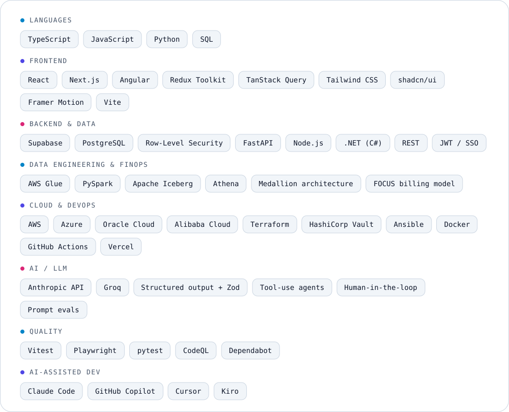

<picture>
  <source media="(prefers-color-scheme: dark)" srcset="assets/banner-dark.svg">
  
</picture>

[**LinkedIn**](https://www.linkedin.com/in/sakar-joshi/) &nbsp;·&nbsp; [**Portfolio**](https://sakar-portfolio-pearl.vercel.app) &nbsp;·&nbsp; [**Monotask**](https://monotask.vercel.app) &nbsp;·&nbsp; [**Kramflow**](https://kramflow.me) &nbsp;·&nbsp; [**Cloudsentry**](https://sakar1601.github.io/cloudsentry/)

&nbsp;

## About

I'm a full-stack engineer who likes to own the whole vertical slice: the data pipeline underneath, the logic in the middle, and the interface people actually touch.

**AI is the through-line.** At **Prama AI** I work on the FinOps-for-AI layer of *Finomics*, the part that shows companies what they really spend on Claude, OpenAI, Gemini, Bedrock and Copilot. In my own products I ship real runtime LLM features: schema-constrained extraction, tool-using agents, and a human approval gate before anything is written or executed.

<table>
<tr>
<td width="33%" valign="top">

**Applied AI** 
Structured output validated with Zod, anti-hallucination prompting, per-user quotas, and human review on every write.

</td>
<td width="33%" valign="top">

**Data and cloud** 
AWS Glue, PySpark and Apache Iceberg pipelines across AWS, Azure, OCI and Alibaba Cloud, with idempotent loads.

</td>
<td width="33%" valign="top">

**Full-stack products** 
React, Next.js and TypeScript on Supabase, with security enforced at the database layer (Row-Level Security).

</td>
</tr>
</table>

&nbsp;

## Featured projects

<table>
<tr>
<td width="50%" valign="top">

**[Monotask](https://github.com/Sakar1601/Monotask)** 
Tasks, calendar, habits and analytics in a minimal monochrome PWA. Claude turns plain English into structured tasks, and every AI suggestion is schema-validated and human-approved before it is written. Two-way Google and Outlook sync.

`React` `Supabase` `RLS` `Claude` `Edge Functions` `PWA` 
[Live](https://monotask.vercel.app) · [Code](https://github.com/Sakar1601/Monotask)

</td>
<td width="50%" valign="top">

**[Cloudsentry](https://github.com/Sakar1601/cloudsentry)** 
A real AWS account drawn as a live graph and watched by three Claude agents (cost, performance, security). The model can only record intent: a human approves before anything runs, and proposals are validated twice.

`FastAPI` `boto3` `Anthropic tool use` `Next.js` `Terraform` 
[Live demo](https://sakar1601.github.io/cloudsentry/) · [Code](https://github.com/Sakar1601/cloudsentry)

</td>
</tr>
<tr>
<td width="50%" valign="top">

**[ResumeBuilder](https://github.com/Sakar1601/resume-builder-app)** 
ATS-friendly resume builder with live preview. AI rewrites bullets or tailors a whole resume to a job description, using Zod-validated output with an automatic retry and prompts that never invent metrics.

`Next.js` `Supabase` `Groq` `Zod` `Playwright` 
[Live](https://resume-builder-app-phi.vercel.app) · [Code](https://github.com/Sakar1601/resume-builder-app)

</td>
<td width="50%" valign="top">

**[Internal Employee Portal](https://github.com/Sakar1601/internal-employee-portal)** 
A small directory app deployed the way a regulated, network-isolated company would: Terraform, two HashiCorp Vault clusters that unseal each other, Ansible and AWX, with no public registries.

`Terraform` `Vault` `Ansible` `AWX` `FastAPI` `React` 
[Live demo](https://sakar1601.github.io/internal-employee-portal/) · [Code](https://github.com/Sakar1601/internal-employee-portal)

</td>
</tr>
</table>

**[Kramflow](https://kramflow.me)** · a multi-tenant live-event operating system where the operator console, phone remote and every display surface share one real-time state. I own the data layer, reliability and AI features: tenant isolation fixes, a rate limiter that survives serverless cold starts, lease-gated live sequencing, and human-reviewed Claude features. ([Code](https://github.com/Workflow-bench/kramflow))

&nbsp;

## Experience

<b>Systems & DevOps Engineer</b> · Prama AI &nbsp;May 2026 – present · Phoenix, AZ (remote)

 

On **Finomics**, a multi-cloud FinOps platform whose flagship is FinOps for AI.

- Built React/TypeScript dashboards tracking AI-tool and SaaS spend across **10+ AI/LLM vendors** with org, team and member drill-down, delivered in 20+ pull requests on one reusable per-provider pattern.
- Built AWS Glue/PySpark to Iceberg pipelines that ingest vendor usage and cost data across **AWS, Azure, Azure China, OCI and Alibaba Cloud**, with MERGE INTO upserts so re-runs stay idempotent.
- Built threshold-driven rightsizing and idle-resource recommendations with live SKU pricing and annualized savings, hardened with multi-metric safety guards, a 50%-per-cycle downsizing cap and peak-utilization gating.
- Found and fixed silent data-loss bugs after live runs, and moved core metrics to 5-minute resolution with peak (max) utilization alongside the mean.

<b>Frontend Engineer Intern</b> · XDuce (client: QBE Insurance) &nbsp;Sep – Dec 2025 · Remote

 

- Built the All Submissions inbox of a cyber-insurance underwriting portal: a sortable, filterable data grid (180+ records per view) with server-side pagination and debounced search.
- Implemented predictable AND-semantics filtering across tabs, search, column filters and a My/All toggle, plus lifecycle-driven Active/Reviewed tabs with Red/Amber/Green risk indicators.
- Shipped **12 production features across 3 sprints** against JIRA user stories.

<b>Web Developer</b> · ASU Project Humanities &nbsp;May – Dec 2025 · Tempe, AZ

 

- Owned the web presence of two ASU platforms serving **5,000+ monthly visitors**, improving accessibility (WCAG) and information architecture across 10+ pages.
- Direct traffic grew **12%**, referral traffic **30%**, pledge-page engagement **20%**, and email open rates **31%** through GA4, Salesforce and Mailchimp workflows.

<b>Software Developer</b> · Macrosoft Creations &nbsp;Sep 2022 – Nov 2023 · Gandhinagar, India

 

- Built Angular SPA features and **.NET (C#) REST APIs** for two enterprise systems (Event Management and Personnel Care) behind an RBAC/ABAC authorization model.
- Delivered multi-step reactive forms, dashboards, QR/ID scanning, webcam attendance, and client-side Excel/PDF reporting, backed by SQL for filtering, pagination and exports.

&nbsp;

## Toolbox

<picture>
  <source media="(prefers-color-scheme: dark)" srcset="assets/skills-dark.svg">
  
</picture>

&nbsp;

## GitHub, by the numbers

<picture>
  <source media="(prefers-color-scheme: dark)" srcset="assets/stats-dark.svg">
  
</picture>

&nbsp;

## Education

**M.S., Information Technology** · Arizona State University, Tempe, AZ &nbsp;2024 – 2025 
**B.E., Computer Engineering** · Kadi Sarva Vishwavidyalaya, Gandhinagar, India &nbsp;2019 – 2023

&nbsp;

## Say hello

I'm happy to talk about FinOps for AI, LLM features that keep a human in the loop, or data pipelines across clouds.
Reach me on [LinkedIn](https://www.linkedin.com/in/sakar-joshi/).

The banner, toolbox and stats above are SVGs generated by [`.github/scripts/generate.py`](.github/scripts/generate.py), and the stats refresh daily through a [GitHub Action](.github/workflows/profile-assets.yml). Fonts: Space Grotesk, Inter and JetBrains Mono.
