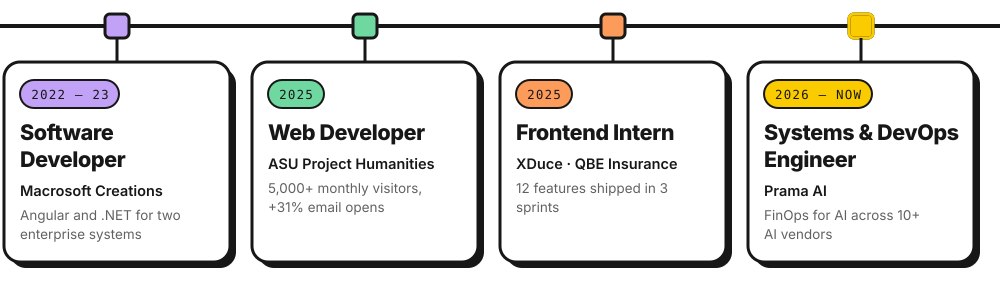
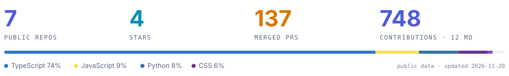

<picture>
  <source media="(prefers-color-scheme: dark)" srcset="assets/banner-dark.svg">
  
</picture>

 

[LinkedIn](https://www.linkedin.com/in/sakar-joshi/) &nbsp;&nbsp;/&nbsp;&nbsp; [Portfolio](https://sakar-portfolio-pearl.vercel.app) &nbsp;&nbsp;/&nbsp;&nbsp; [Kramflow](https://kramflow.me)

 

I work across the whole stack, from the data pipelines to the interface. Right now that means **FinOps for AI** at Prama AI: showing companies what they really spend on Claude, OpenAI, Gemini, Bedrock and Copilot. In my own products I ship LLM features the careful way: schema-validated output, per-user limits, and a human approval before anything is written or run.

 

### Selected work

  <a href="https://github.com/Sakar1601/Monotask"><picture><source media="(prefers-color-scheme: dark)" srcset="assets/card-monotask-dark.svg"></picture></a>
  <a href="https://github.com/Sakar1601/cloudsentry"><picture><source media="(prefers-color-scheme: dark)" srcset="assets/card-cloudsentry-dark.svg"></picture></a>
  <a href="https://github.com/Sakar1601/resume-builder-app"><picture><source media="(prefers-color-scheme: dark)" srcset="assets/card-resume-dark.svg"></picture></a>
  <a href="https://github.com/Sakar1601/internal-employee-portal"><picture><source media="(prefers-color-scheme: dark)" srcset="assets/card-portal-dark.svg"></picture></a>

Also: <a href="https://kramflow.me">Kramflow</a>, a real-time live-event operating system I help build (data layer, reliability and AI) &nbsp;·&nbsp; <a href="https://github.com/Sakar1601?tab=repositories">all repositories</a>

 

### Path

<picture>
  <source media="(prefers-color-scheme: dark)" srcset="assets/timeline-dark.svg">
  
</picture>

M.S. Information Technology, Arizona State University &nbsp;·&nbsp; B.E. Computer Engineering, Kadi Sarva Vishwavidyalaya

 

### Stack

<picture>
  <source media="(prefers-color-scheme: dark)" srcset="assets/ticker-dark.svg">
  
</picture>

 

### Numbers

<picture>
  <source media="(prefers-color-scheme: dark)" srcset="assets/stats-dark.svg">
  
</picture>

 

Say hello on <a href="https://www.linkedin.com/in/sakar-joshi/">LinkedIn</a>. &nbsp;·&nbsp; The visuals are SVGs generated by <a href=".github/scripts/generate.py">a small script</a>; the numbers refresh daily with a <a href=".github/workflows/profile-assets.yml">GitHub Action</a>.

