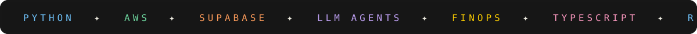
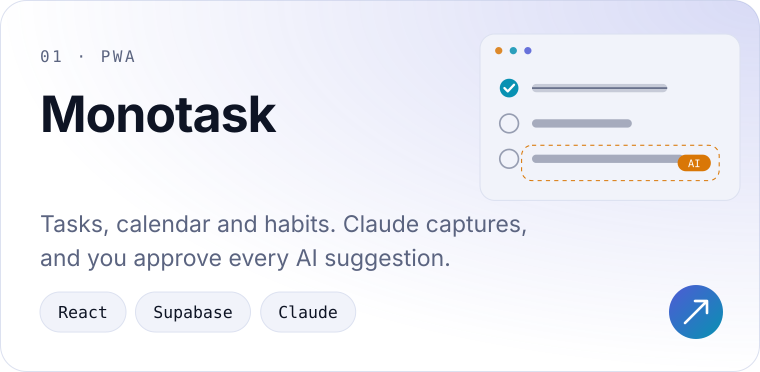
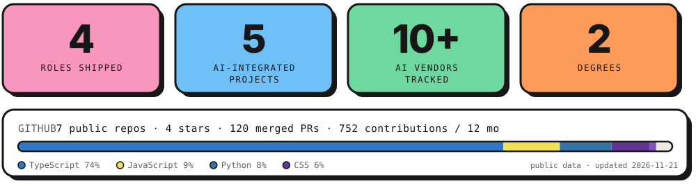

<picture><source media="(prefers-color-scheme: dark)" srcset="assets/banner-dark.svg"></picture>

<picture><source media="(prefers-color-scheme: dark)" srcset="assets/marquee-dark.svg"></picture>

 

<a href="https://sakar-portfolio-pearl.vercel.app"><picture><source media="(prefers-color-scheme: dark)" srcset="assets/btn-portfolio-dark.svg"></picture></a>&nbsp;
<a href="https://www.linkedin.com/in/sakar-joshi/"><picture><source media="(prefers-color-scheme: dark)" srcset="assets/btn-linkedin-dark.svg"></picture></a>&nbsp;
<a href="https://kramflow.me"><picture><source media="(prefers-color-scheme: dark)" srcset="assets/btn-kramflow-dark.svg"></picture></a>

 

<picture><source media="(prefers-color-scheme: dark)" srcset="assets/h-work-dark.svg"></picture>

  <a href="https://github.com/Sakar1601/Monotask"><picture><source media="(prefers-color-scheme: dark)" srcset="assets/card-monotask-dark.svg"></picture></a>
  <a href="https://github.com/Sakar1601/cloudsentry"><picture><source media="(prefers-color-scheme: dark)" srcset="assets/card-cloudsentry-dark.svg"></picture></a>
  <a href="https://github.com/Sakar1601/resume-builder-app"><picture><source media="(prefers-color-scheme: dark)" srcset="assets/card-resume-dark.svg"></picture></a>
  <a href="https://github.com/Sakar1601/internal-employee-portal"><picture><source media="(prefers-color-scheme: dark)" srcset="assets/card-portal-dark.svg"></picture></a>

Also: <a href="https://kramflow.me"><b>Kramflow</b></a>, a real-time live-event operating system I help build (data layer, reliability and AI) &nbsp;·&nbsp; <a href="https://github.com/Sakar1601?tab=repositories">all repositories</a>

 

<picture><source media="(prefers-color-scheme: dark)" srcset="assets/h-path-dark.svg"></picture>

<picture><source media="(prefers-color-scheme: dark)" srcset="assets/timeline-dark.svg"></picture>

M.S. Information Technology, Arizona State University &nbsp;·&nbsp; B.E. Computer Engineering, Kadi Sarva Vishwavidyalaya

 

<picture><source media="(prefers-color-scheme: dark)" srcset="assets/h-numbers-dark.svg"></picture>

<picture><source media="(prefers-color-scheme: dark)" srcset="assets/numbers-dark.svg"></picture>

 

Built in the same style as my <a href="https://sakar-portfolio-pearl.vercel.app">portfolio</a>. The visuals are SVGs generated by <a href=".github/scripts/generate.py">a small script</a>; the GitHub numbers refresh daily with a <a href=".github/workflows/profile-assets.yml">GitHub Action</a>.

